# Hypno 2 Manual

## [PDF Manual](https://www.dropbox.com/scl/fi/2q1u1xpes0ihx7dzi1gox/Hypno-2-Manual-V0.100.pdf?rlkey=opykf18y8yub81ve43etv26o0\&dl=1)

## Quick Start

Connect the USB-C power input to start the device. The three knobs control parameters, and the three buttons handle channel selection and navigation. Touch the screen to access menus and options. Touch anywhere again to toggle between fullscreen display and the control interface.

## Hardware Inputs & Outputs

- **USB-C Power**: Main power input (use official Pi5 adapter)
- **HDMI Output**: Connect to displays, projectors, or capture cards (1080p), only one of the micro HDMI outs can be active at once
- **CV Inputs 1-4**: Control voltage inputs for modular synth integration
- **Trigger Inputs**: Two clock/trigger inputs for BPM sync
- **AUX Audio Input**: Line level audio input for audio-reactive modulation
- **USB Ports**: Connect cameras, capture cards, MIDI controllers, keyboards, and storage drives
- **Built-in Microphone**: Audio-reactive modulation without external audio source

## Controls

The unit includes three pushable rotary encoders (turn and press), three keyboard buttons for navigation and channel selection, and an 800x480 touchscreen for menu interaction.

The keyboard buttons select **Channel 1** (left), **Main** (center) and **Channel 2** (right), and back out of any open menu. Pressing the button of the channel already shown returns to its first parameter page and, on Channel 1 or 2, restarts its video from the start (Settings > System > Doubletap Video Restart, ON by default).

Each encoder corresponds spatially to its screen position: the left encoder (Encoder 0) controls leftmost parameters and UI elements, the center encoder (Encoder 1) controls center elements, and the right encoder (Encoder 2) controls rightmost elements. This spatial mapping applies consistently across all UI contexts including the file browser, settings, and parameter controls.

The interface uses consistent visual language: black backgrounds indicate touchable buttons, white backgrounds mark non-interactive labels, blue highlights show selected or active elements, and color inversion provides visual feedback when buttons are pressed.

### Resetting Encoders
- Tap an encoder to reset the control above it to its default value. On the Main page a channel gain resets to 0. On the Clock page BPM, SRC and LEN go back to their defaults (SRC to OFF, LEN to 4), and a channel's SYNC to ON.
- Encoder values can sometimes be negative, so make sure to try that if it doesn't seem to be working! (MIDI offsets can be made with the cc badge in the mod menu if need be)

## Startup

<figure>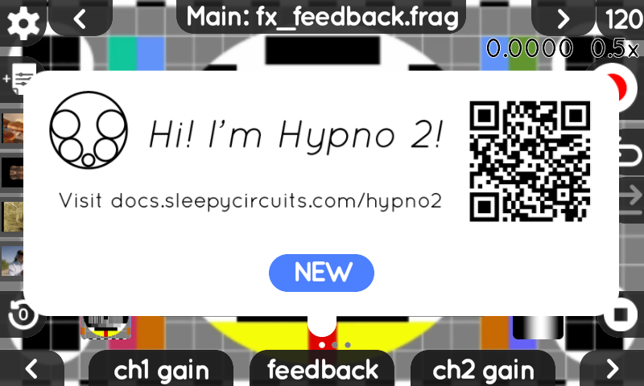<figcaption>
Startup Popup
</figcaption></figure>

Shown on first boot or when previous session data is available.
- **Hypno 2 logo** and QR code linking to docs.sleepycircuits.com/hypno2
- **NEW** button: start a fresh session with default settings
- **RESTORE STATE** button: resume your previous session (only appears when restore data is available)

On the very first boot a welcome screen is followed by setting a device nickname, a password and a Wi-Fi network (Skip is offered). All of them can be changed later in Settings.

## Home Screen / Main

<figure>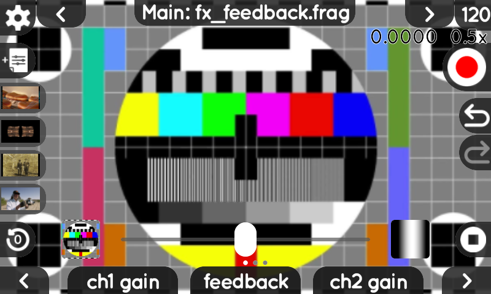<figcaption>
Home Screen
</figcaption></figure>

The main control interface where you spend most of your time.
- **Top left**: settings gear icon. Below it: save preset button (+), then the recent preset thumbnails (tap to load; hold one to save the current state over that slot)
- **Top center**: channel title showing track and shader or clip name (e.g. "Main: fx\_feedback.frag") with a left and right arrow. On Channel 1 or 2 the arrows step to the previous or next shader, or, with a video, image or audio file loaded, to the previous or next file in its folder. On Main they step through effect shaders. Tap the title to open the file browser on the current file (on Main, the effects folder).
- **Top right**: current BPM (tap to open the [Clock page](#clockbpm-page); red when an external clock drives it). If the shader on the channel you are viewing has an error, a warning icon takes its place; tap it to read the shader log. Under it: the frame time and the resolution scale in use.
- **Right side** (top to bottom): record button (red circle), undo arrow, redo arrow. Above the bottom row: play/stop for the selected channel (dimmed while the master transport is stopped) and, with a clip loaded, the playback mode button.
- **Bottom left**: reset/init button. It asks to confirm, then restores default parameter values for the selected channel (all parameters on Main).
- **Bottom center**: the parameter knobs, one label per encoder (on the Hypno 2: left, center, right). Tap a label to open its modulation menu. On the Main page these are **ch1 gain** (left encoder), **feedback** (center encoder) and **ch2 gain** (right encoder).
- **Page dots** above the center knob indicate current parameter page position
- **Bottom corners**: left/right page arrows to navigate parameter pages
- **Along the right edge**: a thin level meter for the audio output (green, yellow near clipping, red when clipping)
- **Along the top and bottom edges**: a breathing blue bar shows background work in progress (downloads, decoding); a green bar shows foreground work

### Undo/Redo

The undo/redo system tracks up to 100 actions including parameter changes (hardware encoders or MIDI), modulation settings, preset loads with full state restoration, shader changes (including shader swaps and the clip or shader a load replaced), texture slot picks, resource switches, loop marker drags, crossfader moves and playback mode changes. The undo (left arrow) and redo (right arrow) buttons in the right sidebar appear bright when available and dimmed when unavailable.

### Recording

Recording captures visuals and audio at internal display resolution and frame rate with automatic timestamp-based naming. Press the record button (turns red when active) to start, perform your visual sequence, then press again to stop. Each recording is saved as a single .mov file in VIDOS-Resources/Recordings/ and appears there once it has finished saving, when it is assigned to the active channel (Channel 1 if Main is selected) for immediate resampling. Turn on Settings > System > Assignment Popup to be asked first. Hold the record button to turn Quantized Recording on or off (a notice confirms): with it on, recording starts and stops on the next bar of the clock instead of at once, and stops when the transport stops. When signed in to Sleepy Cloud, each recording is also uploaded in the background to the Recordings folder of your Library; a notice says when it has gone up, or that it will upload once the Hypno 2 is online. If your Sleepy Cloud storage is full, the notice says "Not uploaded: Sleepy Cloud storage full"; the recording stays on the Hypno 2 and uploads by itself once there is room again (after you free space or change plan). The first time a recording plays on shadygram.com it is compressed there to save storage; the Hypno 2 keeps its own copy as recorded. The channel plays the file on the Hypno 2 right away and is never interrupted by the upload. A new recording can start once the last one has finished saving. If storage runs low, recording stops and saves what it has. Changing the render resolution also stops and saves the current recording.

### Presets

Presets save as `.json` files containing complete system state including all parameters, modulation settings, and MIDI mappings. Tap the save button in the left sidebar to save the current state. Tap any of the recent preset thumbnails (4 on the Hypno 2 screen) to instantly load that preset. tap the add preset button at the top to add a new preset. Saved into VIDOS-Resources/Presets folder. Hold a recent preset thumbnail to save the current state as a new preset in that slot ("Slot Overwritten"); the old preset file is kept. Saving is blocked while recording. When signed in to Sleepy Cloud, saved presets are also uploaded to the Presets folder of your Library (a preset saved offline goes up once the Hypno 2 is online), and presets saved on your other devices are downloaded into the Presets folder.

## Mixer & FX (Effect Shader fx_feedback.frag shown)

<figure><figcaption>
Main — Page 1: Mixer (CC 0-2)
</figcaption></figure>

The Main track (MIDI Channel 16) controls the global mixer and feedback shader (fx\_feedback.frag). The top bar shows "Main:" followed by the FX shader name. These parameters affect how Channels 1 and 2 are blended together and how the feedback loop behaves.

Channel mixing controls — how much of each channel appears in the final output.
- **ch1 gain** (left encoder, CC 0): volume/level of Channel 1 (Track A) in the mix
- **feedback** (center encoder, CC 1): amount of frame-to-frame feedback effect
- **ch2 gain** (right encoder, CC 2): volume/level of Channel 2 (Track B) in the mix

Each gain runs from -1 to 1: 1 is full, 0 takes the channel out of the mix, and below 0 subtracts its picture from the other channel (its sound stays silent). The knob taps (haptics) as you turn it onto 0. With System Link on, a gain below 0 is shown as 0 on the other linked devices.

Controls how the feedback frame is transformed before being mixed back in.
- **fb x** (left encoder, CC 3): horizontal offset of the feedback frame
- **fb zoom** (center encoder, CC 4): zoom/scale amount applied to the feedback
- **fb y** (right encoder, CC 5): vertical offset of the feedback frame

Feedback rotation and luminance keying thresholds.
- **fb rotate** (left encoder, CC 6): rotation angle applied to the feedback frame
- **low key** (center encoder, CC 7): low luminance keying threshold — pixels darker than this are keyed out
- **hi key** (right encoder, CC 8): high luminance keying threshold — pixels brighter than this are keyed out

### Crossfader

On the Main track's home screen a crossfader sits where a channel's seek bar would be, with a live picture of Channel 1 at its left end and Channel 2 at its right. Drag its thumb (a drag must start on the thumb; a stray tap does nothing) to fade between the two channels; in the middle both are at full. Double-tap it to put it back in the middle. A channel faded out keeps playing, so it is in time when you fade it back in. An empty channel's end is dimmed. Tap a preview to open that track. The crossfader is saved with presets and is undoable. With System Link on, it follows the shadygram mixer's crossfader and moves it.

### Video & Audio Mixing

When both audio and video are present you will see 3 badges above that channel's gain: A, &, V 
Each track supports independent gain control on Audio & Video, tap "A" / "V" to controll the corresponding gain, tap "&" to control both at once.

Audio outputs to the default sound device, make sure at least one device is unmuted in Settings->Audio (Out Button)
Audio devices get mixed in with unity (1.) gain. Tap the name of a sound device to assign it to a channel to control it with the mixer gain controls.

Channel Audio be Assigned to:
- **USB Audio Devices**: Unity gain by default, assignable to channels if gain control is desired
- **WAV Files**: Load audio files for synchronized playback with video
- **Capture Card Audio**: Audio from USB capture devices automatically linked to video
- **NDI Audio**: Network audio streams from NDI sources
- **Microphone**: Built-in or USB microphone input

### Audio/Video Playback Modes

Change playback mode by touching the mode button above the play/stop button on the home screen (it appears when a video or audio file is loaded). Each tap steps to the next mode: Loop, 1-Shot, Bounce, Next, Previous, Random, Walk, Shuffle. Each channel has its own mode.

The seek bar under a video or audio channel is touchable: drag along it to scrub. It shows the clip's waveform, and for a Sleepy Cloud clip that is still downloading, a light band along its bottom edge marks the parts already on the Hypno 2. The bars at its ends are the loop in and loop out markers: drag one to move it (the same values as the loop in and loop out knobs, CC 0 and CC 2). A marker drag is undoable. With System Link on, seeks and markers follow shadygram's mixer and move it.

- **Loop**: continuously repeats the clip.
- **1-Shot**: plays once, then stops on the final frame.
- **Bounce**: alternates between forward and reverse.

The remaining modes are follow actions: when the clip ends, the channel moves on to another file in the same folder.
- **Next** / **Previous**: the next or previous file, wrapping around at the ends of the folder.
- **Random**: any other file in the folder.
- **Walk**: one file forward or back, picked at random each time.
- **Shuffle**: every other file once in a random order, then a new order.

### Fullscreen Mode

<figure>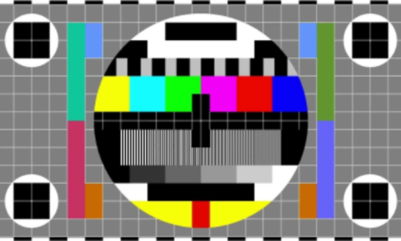<figcaption>
Fullscreen Mode
</figcaption></figure>

Clean video output with all UI elements hidden.
- The shader output fills the entire 800x480 screen
- Touch anywhere on the screen to return to the control interface
- Useful during live performance or when projecting to an audience

## Track A Parameter Pages (Ch 1)

<figure>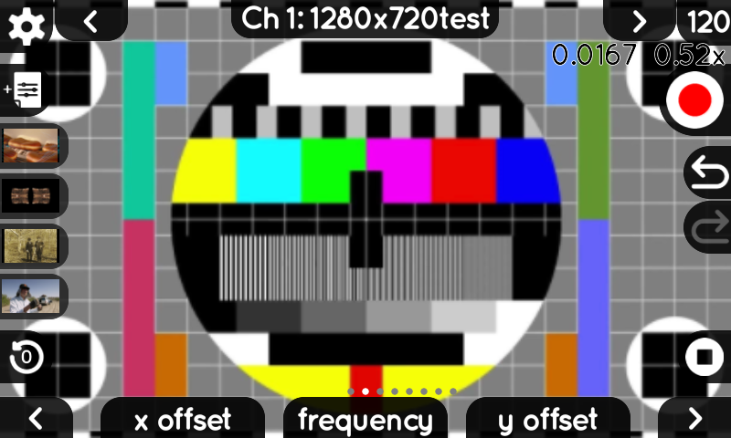<figcaption>
Track A — Page 1 (CC 0-2)
</figcaption></figure>

Track A (Channel 1) parameter pages. The top bar shows "Ch 1:" followed by the loaded shader name. Each page has 3 parameter knobs at the bottom controlled by the left, center, and right hardware encoders. Tap any parameter name to open its modulation menu. "---" indicates an unused parameter slot. Page dots above the center knob show which page you're on. Use the left/right arrows to navigate between pages.

**Video and audio clips:** with a clip loaded, the first three knobs of page 1 become **loop in** (left, CC 0), **framerate** (center, CC 1) and **loop out** (right, CC 2), and every shader parameter below moves up three CCs (x offset is then CC 3, and so on). Framerate is the clip's playback speed: 0 is its normal speed, -1 stops it, and below that it plays backward. The knob taps (haptics) at stopped and at normal speed forward and backward. Loop out at 0 plays to the end of the clip. It reads **pitch** instead while the clock source is not OFF and the clip has sound. With a clip loaded, a channel's BPM is measured from its audio when it loads (see the [Clock page](#clockbpm-page)).

**Texture slots:** a shader that takes pictures in (an ISF shader with image inputs) shows how many of its slots are filled after its name, e.g. "(1/2)", and a picture icon beside the title. Tap the icon to open a row of squares, one per slot (a filled slot shows its picture or video, an empty one its name); tap a square to open the file browser, then **Load** an image or video to put it in that slot. Tap the title to open the shader file in the browser. Loading a clip or another shader over a channel, and filling a slot, can all be undone.

Position and speed controls for Channel 1's shader.
- **x offset** (left encoder, CC 0): horizontal position of the shader pattern
- **frequency** (center encoder, CC 1): speed or frequency of the shader animation
- **y offset** (right encoder, CC 2): vertical position of the shader pattern

Cropping and rotation controls.
- **x crop min** (left encoder, CC 3): left edge of the horizontal crop window
- **rotation** (center encoder, CC 4): rotation angle of the shader output
- **x crop max** (right encoder, CC 5): right edge of the horizontal crop window

Vertical cropping controls.
- **y crop min** (left encoder, CC 6): top edge of the vertical crop window
- **---** (center encoder, CC 7): unassigned slot
- **y crop max** (right encoder, CC 8): bottom edge of the vertical crop window

Aspect ratio controls.
- **aspect x** (left encoder, CC 9): horizontal stretch/squeeze of the output
- **---** (center encoder, CC 10): unassigned slot
- **aspect y** (right encoder, CC 11): vertical stretch/squeeze of the output

Mirror/reflection controls.
- **mirror amt** (left encoder, CC 12): intensity of the mirror effect
- **mirror rot** (center encoder, CC 13): rotation angle of the mirror axis
- **---** (right encoder, CC 14): unassigned slot

Luminance and polarization controls.
- **luma min** (left encoder, CC 15): minimum luminance threshold (darks cutoff)
- **polarization** (center encoder, CC 16): polarization effect amount
- **luma max** (right encoder, CC 17): maximum luminance threshold (lights cutoff)

Cross-modulation and feedback modulation controls.
- **---** (left encoder, CC 18): unassigned slot
- **cross mod** (center encoder, CC 19): amount of cross-modulation between channels
- **fb mod amt** (right encoder, CC 20): feedback modulation depth

Color adjustment controls (OKLab color space).
- **hue** (left encoder, CC 63): hue shift of the shader output
- **chrominance** (center encoder, CC 64): color saturation intensity
- **lightness** (right encoder, CC 65): brightness/lightness of the output


Parameters vary by loaded shader. The CC numbers shown here are defaults — each parameter can be remapped to any CC number (0-127) through the modulation menu.


## Track B Parameter Pages (Ch 2) (Generative shape: sin.frag shown)

<figure>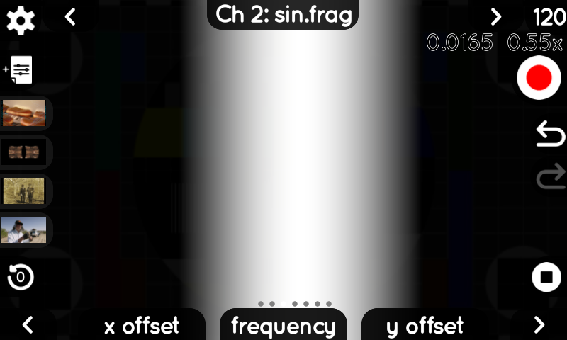<figcaption>
Track B — Page 1 (CC 0-2)
</figcaption></figure>

Track B (Channel 2) uses the same layout as Track A. The top bar shows "Ch 2:" followed by the loaded shader name. Parameters vary depending on which shader is loaded — different shaders expose different controls (sin.frag shown in these screenshots).

Position and speed controls for Channel 2's shader.
- **x offset** (left encoder, CC 0): horizontal position of the shader pattern
- **frequency** (center encoder, CC 1): speed or frequency of the shader animation
- **y offset** (right encoder, CC 2): vertical position of the shader pattern

Folding and rotation controls (specific to sin.frag shader).
- **fold axis** (left encoder, CC 3): axis angle for the folding effect
- **rotation** (center encoder, CC 4): rotation of the shader pattern
- **fold shape** (right encoder, CC 5): shape/intensity of the fold

Aspect and polarization controls.
- **aspect x** (left encoder, CC 6): horizontal stretch/squeeze
- **polarization** (center encoder, CC 7): polarization effect amount
- **aspect y** (right encoder, CC 8): vertical stretch/squeeze

Luminance threshold controls.
- **luma min** (left encoder, CC 9): minimum luminance cutoff
- **---** (center encoder, CC 10): unassigned slot
- **luma max** (right encoder, CC 11): maximum luminance cutoff

Mirror/reflection controls.
- **mirror amt** (left encoder, CC 12): intensity of the mirror effect
- **mirror rot** (center encoder, CC 13): rotation angle of the mirror axis
- **---** (right encoder, CC 14): unassigned slot

Cross-modulation and feedback modulation controls.
- **---** (left encoder, CC 60): unassigned slot
- **cross mod** (center encoder, CC 61): amount of cross-modulation between channels
- **fb mod amt** (right encoder, CC 62): feedback modulation depth

Color adjustment controls (OKLab color space).
- **hue** (left encoder, CC 63): hue shift of the shader output
- **chrominance** (center encoder, CC 64): color saturation intensity
- **lightness** (right encoder, CC 65): brightness/lightness of the output

## Modulation Pages (Parameter label tap)

<figure>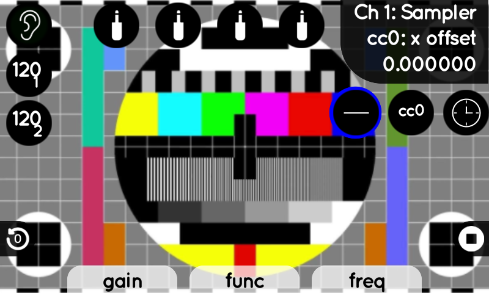<figcaption>
Modulation — Internal LFO
</figcaption></figure>

The modulation menu opens when you tap a parameter name on any parameter page. Each parameter can receive modulation from multiple sources with independent gain control. The header in the top-right displays the channel name, CC number, parameter name, and current value.

The default view shows the internal LFO (Low Frequency Oscillator) modulation source.
- **Top-right header**: "Ch 1: Sampler", "cc0: x offset", and current value (0.000000). The cc line turns yellow when this parameter's MIDI CC has been remapped.
- **Top left badges**: ear/audio input badge, then the 4 CV input jack badges
- **Left column badges** (below the ear): audio track badges (Ch 1, Ch 2) for using track audio as modulation, each showing that channel's BPM
- **Right badges**: the internal LFO (showing its waveform), the MIDI CC badge ("cc0"), and the clock badge. The clock badge shows the BPM of the clock this parameter is synced to, and has a red ring while sync or re-trigger is on.
- **Blue ring** highlights the currently selected modulation source
- **Bottom knobs**: **gain** (left — modulation amplitude, bipolar), **func** (center — waveform shape selector), **freq** (right — LFO speed)
- Available waveforms: Inf, Ramp, Tri, Sin, Cos, Tan, Rnd, Pulse, Exp, Log, StpRnd, Bounce, Chaos, Heart, Pend
- **Bottom left**: init button (asks "INITIALIZE MOD?", then resets this parameter and its modulation). **Right side**: play/stop button, which pauses or resumes this parameter's modulation.

The scope renderer provides real-time waveform displays for CV input levels, MIDI CC values, and audio levels. LED-style numeric indicators show precise values for control signals, useful for calibrating modulation depths and monitoring external input.

<figure><figcaption>
Modulation — Audio Input, Page 1: Gain &amp; Smooth
</figcaption></figure>

Audio input (AUX/microphone) modulation settings, page 1 of 2. The ear badge on the left is selected (blue ring). The built-in microphone provides audio-following modulation with adjustable magnitude (bipolar -1 to +1) and slew rate (0 to 1). If a jack is plugged into aux, the ear is replaced.
- **gain** (left encoder): modulation depth — how strongly audio input affects the parameter
- **smooth** (center encoder): response smoothing — higher values create slower, smoother modulation response
- **src** (right encoder): which input the ear follows — **auto** (the aux jack when a cable is plugged in, otherwise the built-in microphone), **mic** or **aux**. The aux jack has no frequency bands, so page 2 is only available with the microphone.

<figure>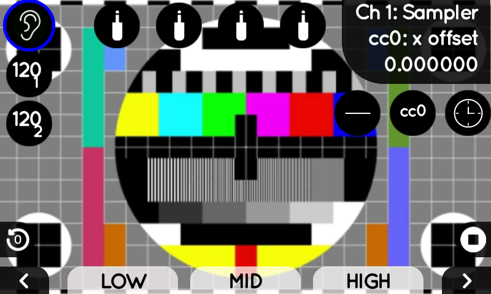<figcaption>
Modulation — Audio Input, Page 2: Frequency Bands
</figcaption></figure>

Audio input frequency band controls, page 2 of 2. Lets you isolate specific frequency ranges.
- **LOW** (left encoder): low frequency band gain (bass response)
- **MID** (center encoder): mid frequency band gain
- **HIGH** (right encoder): high frequency band gain (treble response)
- Colored glow indicators on the badges show real-time band activity (red/green/blue)

<figure>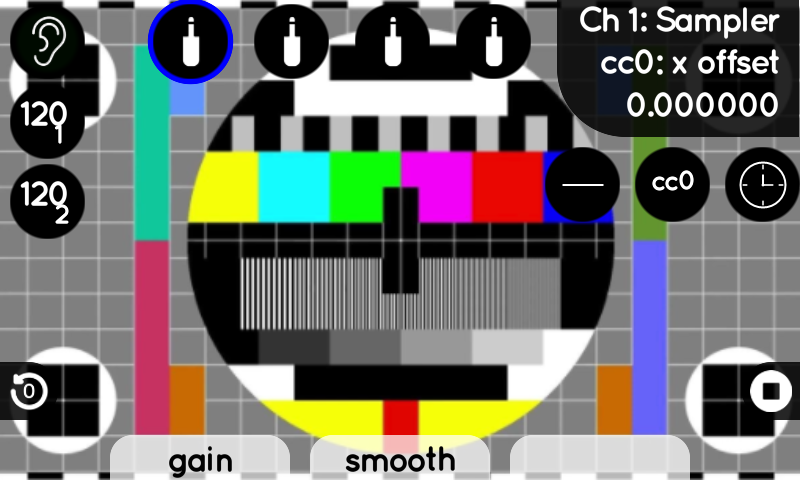<figcaption>
Modulation — CV Input
</figcaption></figure>

Control voltage input modulation settings. One of the 4 CV jack badges on the left is selected (blue ring).
- **gain** (left encoder): modulation depth from the selected CV input jack
- **smooth** (center encoder): input smoothing to reduce noise or jitter on the CV signal
- Select which CV jack (1-4) by tapping the corresponding badge on the left

<figure>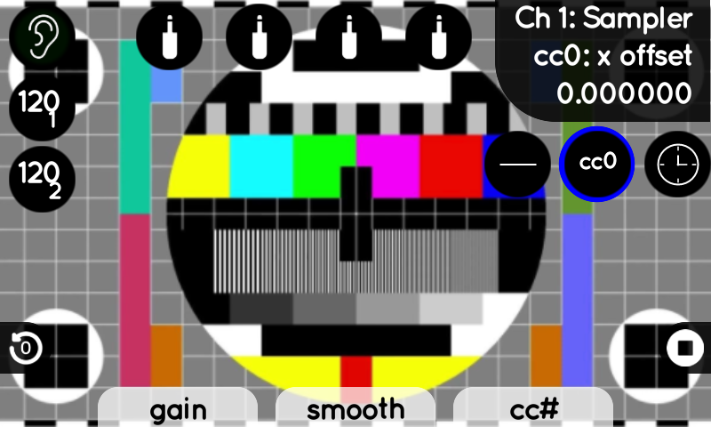<figcaption>
Modulation — MIDI CC
</figcaption></figure>

MIDI Control Change modulation settings. The "cc0" badge on the right is selected (blue ring). Each parameter can be remapped to respond to any MIDI CC number between 0-127, independent of its default CC assignment. This allows custom MIDI controller layouts. MIDI mappings save with presets.
- **gain** (left encoder): modulation depth from incoming MIDI CC messages (bipolar)
- **smooth** (center encoder): input smoothing for the MIDI CC signal (0 to 1)
- **cc#** (right encoder): MIDI CC number mapping (0-127) — remap which CC number controls this parameter

<figure>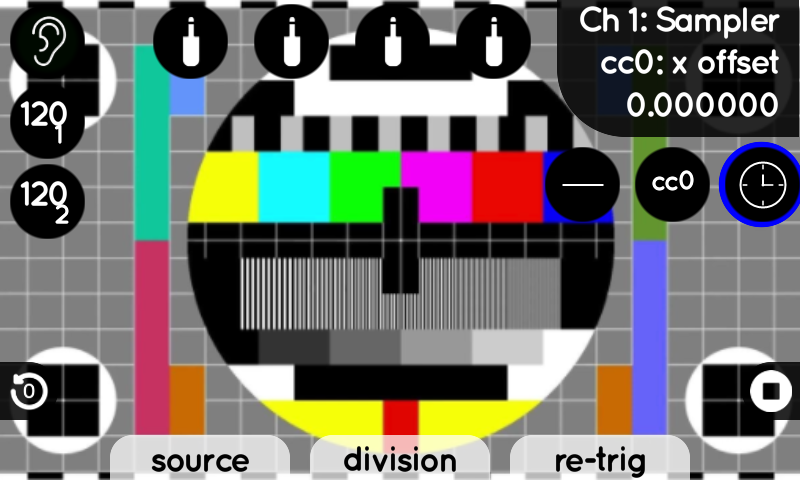<figcaption>
Modulation — Clock/BPM Sync
</figcaption></figure>

Clock and BPM synchronization settings. When BPM sync is enabled, modulation locks to external clock sources through two independent trigger inputs. The trigger interval BPM display converts incoming trigger frequencies to beats per minute readings at 64ppqn, with each trigger input showing its own readout.
- **source** (left encoder): clock source selection — OFF, BPM (the master tempo), CLK1 (trigger input 1), CLK2 (trigger input 2)
- **division** (center encoder): clock division ratio — 1/32, 1/16, 1/8, 1/4, 1/2, 1/1, 2x, 4x, 8x, 16x
- **re-trig** (right encoder): retrigger ON/OFF — resets the LFO phase on each clock pulse

<figure>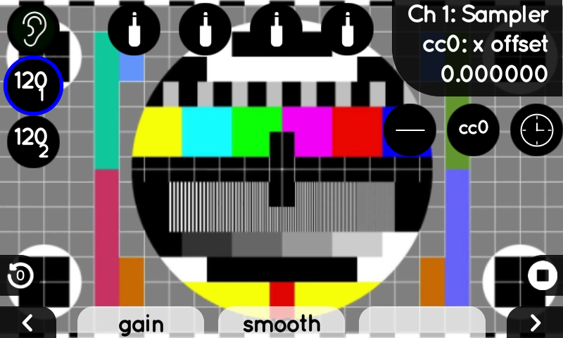<figcaption>
Modulation — Audio Track, Page 1: Gain &amp; Smooth
</figcaption></figure>

Audio track modulation settings, page 1 of 2. Uses audio from a video channel's loaded media as a modulation source. A track badge at the bottom is selected (blue ring, shows BPM readout).
- **gain** (left encoder): modulation depth from the audio track
- **smooth** (center encoder): response smoothing for the audio signal

<figure>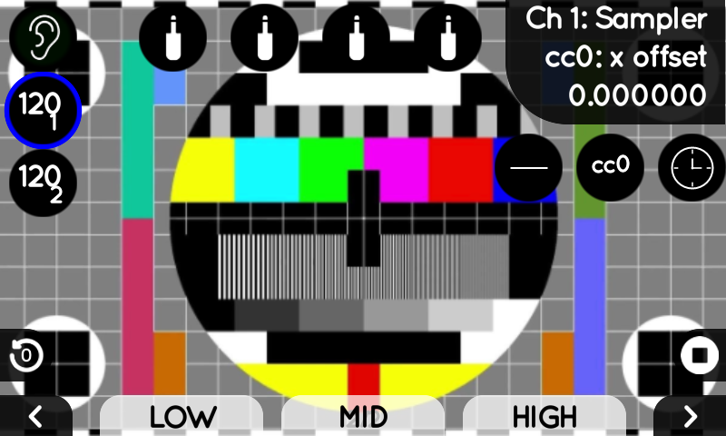<figcaption>
Modulation — Audio Track, Page 2: Frequency Bands
</figcaption></figure>

Audio track frequency band controls, page 2 of 2. Same band controls as the ear/audio input.
- **LOW** (left encoder): low frequency band gain (bass)
- **MID** (center encoder): mid frequency band gain
- **HIGH** (right encoder): high frequency band gain (treble)

## Clock/BPM Page

<figure>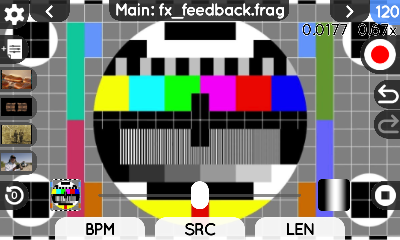<figcaption>
Clock / BPM Settings
</figcaption></figure>

Global tempo and clock configuration. Access this page by tapping the BPM value in the top right corner.
- **BPM** (left encoder): set the master tempo in beats per minute. Only adjustable when the clock is the Hypno 2's own or System Link's; with an external clock it shows that clock's measured tempo ("ext").
- **SRC** (center encoder): clock source — **OFF** (no clock), **INT** (internal clock), **EXT** (MIDI clock), **CLK** (analog clock input jack), **LNK** (System Link's shared tempo, chosen by the link itself, never by hand)
- **LEN** (right encoder): sequence length for clock-synced recording start/stop (default 4)

When Channel 1/2 is selected
- **BPM** (left encoder): this channel's tempo in beats per minute. It is measured from the clip's audio when a clip loads, so set it by hand only if the detection is off.
- **SYNC** (center encoder, while the clock source is not OFF): ON keeps this channel's speed matched to the master tempo (its tempo, or half or double it, whichever is closest): the framerate knob moves to that speed whenever the tempo changes. While linked with System Link, SYNC and the speed are shared with every linked device

## File Browser

<figure>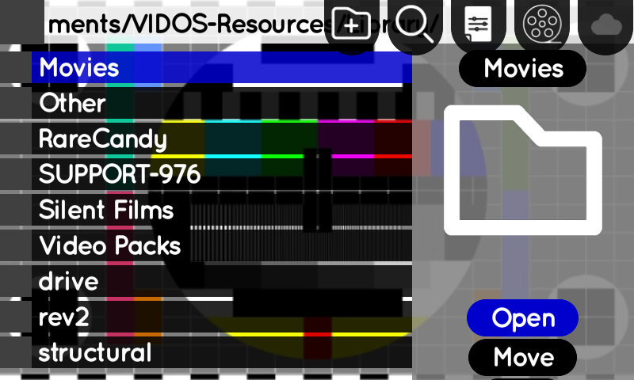<figcaption>
File Browser
</figcaption></figure>

Browse and manage files on internal storage, USB drives and Sleepy Cloud. The file browser uses checkboxes for multi-selection with a master checkbox in the header to select/clear all.
- **Top bar**: the current directory path (tap it to go up one folder). On the right, shortcut icons: USB drives (when one is connected), Sleepy Cloud (when installed; dimmed while signed out or offline), cameras and NDI sources (when one is found), the video content folder, the Presets folder, search (magnifying glass) and new folder (+).
- **File list** (left side): folders and files displayed as a scrollable list — blue highlight shows the currently selected item
- **Right side**: preview thumbnail of the selected file/folder, name label below the thumbnail (tap the name to rename it with the keyboard)
- **Action buttons** (bottom-right) depend on what is selected: **Open** (folders), **Load**, **View** (text, shader and PDF files), **Decode**, **Encode**, **Move**, **Zip** / **Unzip**, **Delete**, and for Sleepy Cloud items **Keep Offline** and **Online-Only**. With several files checked the count is added (e.g. "Move 3").
- Left encoder scrolls the file list, center encoder turns the pages of the list, right encoder selects an action. Pressing the right encoder runs the selected action; pressing the left or center encoder runs the first one.

The system automatically generates and caches thumbnails for images and videos. File metadata is indexed for faster browsing of large directories. Long filenames scroll horizontally to show the full name.

### Sleepy Cloud files

Your Sleepy Cloud Library appears as a folder (Settings > Cloud > Folder: SleepyCloud/, or the cloud icon in the browser's top bar). Each row carries a small badge: a cloud for an online-only file, a check for one already on the Hypno 2, a pin for one kept offline, and a percentage while it downloads. Items shared with you or purchased carry their own badge (they are read-only).
- **Load** works on an online-only file directly: it downloads what it needs while the current picture keeps running, and the blue bar along the top of the screen shows the progress.
- **Keep Offline** stores a copy on the Hypno 2; **Online-Only** frees the local copy. Going online-only also deletes the decoded frames of that video, so a re-download needs a new Decode, and the Hypno 2 asks before doing it.
- **Delete** asks which copy to remove: the **Cloud File** (for everyone with access, only for your own items), the **Local File** or the **Decoded Frames**. Items shared with you cannot be moved or removed from the cloud.
- A file that is loaded on a track cannot be deleted: the Hypno 2 tells you to unload it first.

### Shaders that did not compile

If a shader fails to compile on your Hypno 2, its row gets a red warning icon and its name is greyed. The Hypno 2 remembers this, so the icon is there the next time you open the folder. The left and right arrows on the main screen skip these shaders when you step through a folder. You can still load one from the file browser to try it again. The warning clears by itself once the shader compiles, or when you edit it.

## Supported File Formats

### Images
- **JPEG**: Raster images with EXIF orientation support
- **PNG**: Raster images with transparency support
- **BMP, GIF**: Additional raster formats
- **SVG**: Vector graphics rendered at optimal quality, cached at multiple scales for smooth zooming

### Video
- **MP4**: Primary format with H.264/H.265 encoding
- **MOV, WebM, MKV, AVI**: Additional container formats
- Videos play straight away with **Load** — no decoding needed. Videos taller than 720 lines are scaled down to 720.
- **Decode** is still available for any video that has not been decoded. A decoded video gives the fastest scrubbing and reverse playback, especially for long clips and phone footage, and takes less processing power to play. Once a video is decoded, Load uses the decoded version. Until decoding finishes, the video plays from its original file.
- Audio inside a video is extracted automatically the first time the video is loaded.

### Audio
- **WAV**: Primary audio format for mixing and playback
- **MP3, OGG, FLAC**: Additional audio formats

### Shaders & Text
- **GLSL (.frag)**: Fragment shaders for custom visual effects with live editing
- **ISF (.fs, .isf)**: Interactive Shader Format shaders, with their parameters mapped to the knobs automatically
- **Text files** (TXT, MD, JSON, LOG and common code and config files): open with **View**, with syntax highlighting. Markdown files are shown formatted, and the right encoder press follows a highlighted link.
- **PDF**: open with **View**
- **Presets** (.json): **Load** restores the saved state

Where a shader loads depends on whether it takes a picture in, not on which
folder you opened it from:

- Shaders that make their own image load on Channel 1 or 2.
- Effects — shaders that process an incoming image — load on Main, where they
  receive the mixed output of both channels. Touching one while a channel is
  selected still loads it on Main, and says so.

An ISF shader is sorted by what it declares, so its filename does not matter.
An ISF effect can also be loaded on a channel, where you pick the picture it
processes yourself through the texture slot in the title bar.

Main will not take a shader that reads no image, since it would cover both
channels; touching one there shows a short message instead.

### File Operations

Select files individually by touching checkboxes, or select all with the master checkbox. Available batch operations include:

- **Move**: Relocate files to another directory with conflict detection
- **Zip** / **Unzip**: Pack the selected files into one archive, or unpack a .zip next to itself
- **Delete**: Remove selected files with confirmation. For videos you choose whether to delete the encoded file, the decoded frames, or both. Files loaded on a track cannot be deleted.
- **Encode**: Convert videos to optimized format for playback
- **Decode**: Convert videos to frames for the fastest scrubbing and reverse playback

Progress tracking shows real-time progress bars with frame counts and cancellation support. Create new folders by touching the (+) button — this opens the keyboard in folder creation mode with a yellow/orange header.

### USB Drive Management

USB drives mount automatically when connected, with support for multiple partitions. Safe removal ensures proper unmounting. Images, video and audio on a USB drive cannot be loaded straight onto a channel: move them to the Hypno 2's storage first (shaders and presets load from a drive).


**Pro Tip**: Use the master checkbox to select all files, then deselect individual files to exclude them from batch operations.



**Important**: Wait for file operations to complete before disconnecting USB drives to prevent data loss.


### Search

<figure>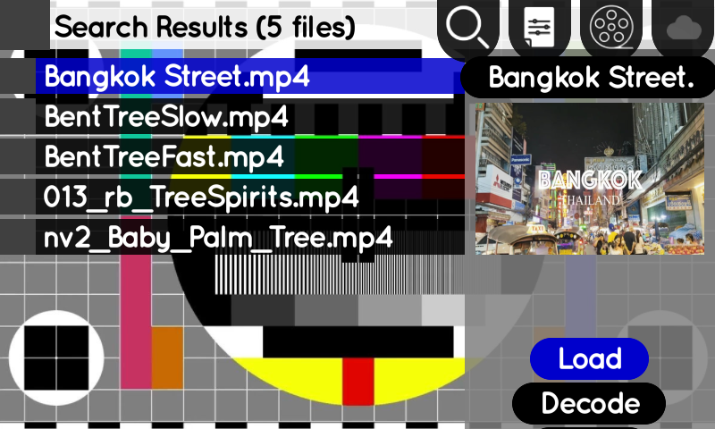<figcaption>
File Browser — Search Results
</figcaption></figure>

Touch the search icon and type a name to find files in the Resources folder. Search results appear asynchronously without blocking the UI, and the list stops at the first 100 matches. With Settings > System > Web Search ON, matching online videos are listed too: select one and use **Download** (or **Cancel DL** while it downloads).
- **Header**: "Search Results (N files)" showing the number of matches found
- **File list**: matching files listed by name with blue selection highlight
- **Right side**: preview thumbnail of the selected result
- **Action buttons**: **Load** (assign file to the active channel), **Move** (relocate the file), and the other actions that apply to the selected file

## Settings

Access settings through the gear icon on the home screen. The settings menu is organized into tabs along the left column.

<figure>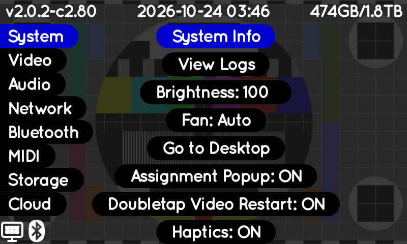<figcaption>
Settings — System
</figcaption></figure>

### System

System information and general device settings.
- **Top bar**: firmware version (e.g. v0.0.163, followed by the control board version when known), current date/time, storage usage (e.g. 436/1876GB). When a newer firmware is available the version turns into a yellow **Update** button ("Update: v1 > v2").
- **Status icons** (top right): Wi-Fi or Ethernet connection and Bluetooth on/off
- **Tab list** (left column): System (selected, highlighted blue), Video, Audio, Network, Bluetooth, MIDI, Storage, Cloud
- **System Info**: hardware and software information, with **FACTORY RESET**, **FORCE UPDATE**, **CHANGE PASSWORD** and **CHANGE NICKNAME**
- **View Logs**: open the System, MIDI, NDI, Serial or Shader log
- **Brightness: 100%**: screen brightness (turn to adjust, tap the center encoder to reset)
- **Fan: Auto**: fan control mode (Auto / Off / Max) for silent operation
- **Go to Desktop**: switch to Raspberry Pi desktop mode
- **Assignment Popup: OFF**: when ON, a finished recording asks before it is assigned to the active channel; when OFF it is assigned at once
- **Doubletap Video Restart: ON**: pressing the keyboard button of the channel already shown restarts that channel's video
- **Haptics: ON**: toggle vibration feedback on encoder turns (ON/OFF)
- **Web Search: OFF**: when ON, file browser searches also list online videos that can be downloaded
- **Demo Mode: OFF**: when ON, deleting files, overwriting presets and factory reset are disabled
- **Mic Gain: 1.0x**: input gain of the built-in microphone (0x to 2x)
- **Encoder Accel: 1.00**: how quickly the encoders speed up when turned fast (0.10 to 5.00)
- **Register Device** (only while the Hypno 2 is not registered) and **Send Crash Report** (only when registered and online)

<figure>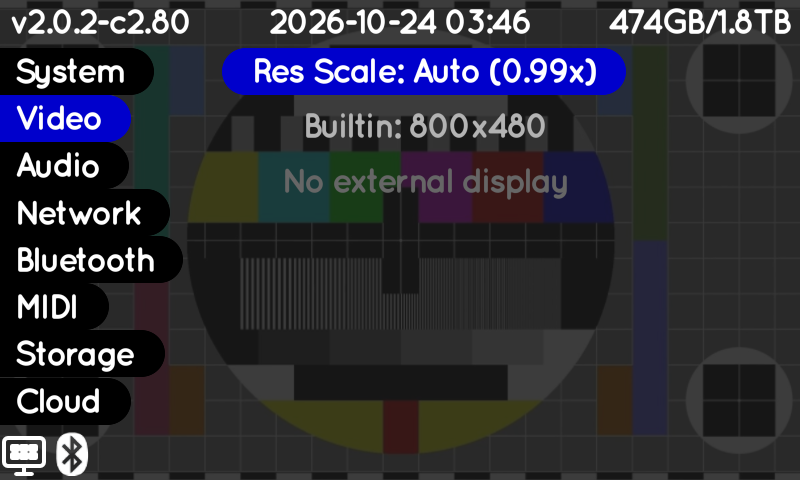<figcaption>
Settings — Video
</figcaption></figure>

### Video

Resolution scale, and the output resolution for the HDMI display.
- **Res Scale: Auto**: the share of the full resolution the shaders render at. On **Auto** it renders as sharp as possible while holding 30 frames per second. It starts at half and moves by itself, and the row shows the scale it is using. Turn to set a fixed scale from 0.25x to 1x, in 0.05 steps; turning past 1x goes back to Auto. Tap to step through Auto, 0.25x, 0.5x, 0.75x and 1x. Press the center encoder to go back to Auto. The scale in use is shown next to the frame time on the main screen. While recording, a change waits until the recording stops.
- **Resolution list**: available HDMI output modes detected from the connected display — each entry shows resolution and refresh rate (e.g. 1920x1080 @60Hz)
- **Builtin: 800x480**: shows the built-in touchscreen resolution (not changeable)
- **Selected resolution** highlighted in blue, starred item indicates currently selected mode/EDID.
- Tap any resolution to switch the HDMI output to that mode
- With no display connected, the list is replaced by "No external display"

<figure>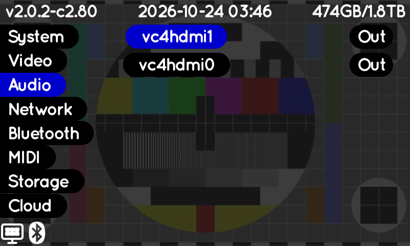<figcaption>
Settings — Audio
</figcaption></figure>

### Audio

Audio output device configuration.
- **Device list**: each audio device shown with its name — "vc4hdmi1" (HDMI port 1), "vc4hdmi0" (HDMI port 0)
- **Out** toggle buttons: enable/disable audio output per device (blue = selected, dark = muted). The **In** and **Out** buttons also act as level meters, shifting from green toward yellow as the signal gets louder.
- A \* after a device name marks the device in use as the main input or output, and the sample rate is shown in brackets (e.g. [48k])
- USB capture cards are not listed here: their audio follows their video
- USB audio devices appear in this list when connected, with both **In** and **Out** toggle options
- Track assignment prefixes appear for input devices (M: for Unity Gain, 1: for Track A assign, 2: for Track B assign), tap to rotate assignment

<figure>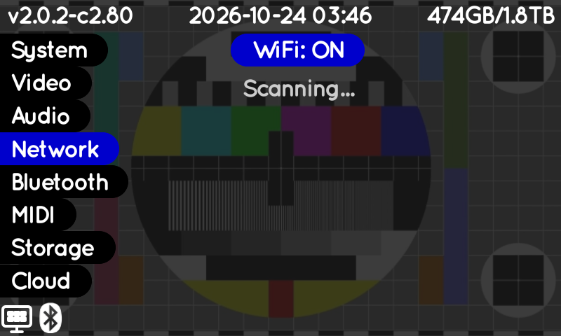<figcaption>
Settings — Network
</figcaption></figure>

### Network

Wi-Fi network configuration.
- **WiFi: ON** toggle button: enable or disable the Wi-Fi radio (tap to toggle)
- **Scanning...** status: the device is actively searching for available networks
- When networks are found, they appear as a list with signal strength indicators
- Tap a network name to connect — a keyboard appears for password entry if the network is secured
- Connected networks show "(Connected)" label

<figure>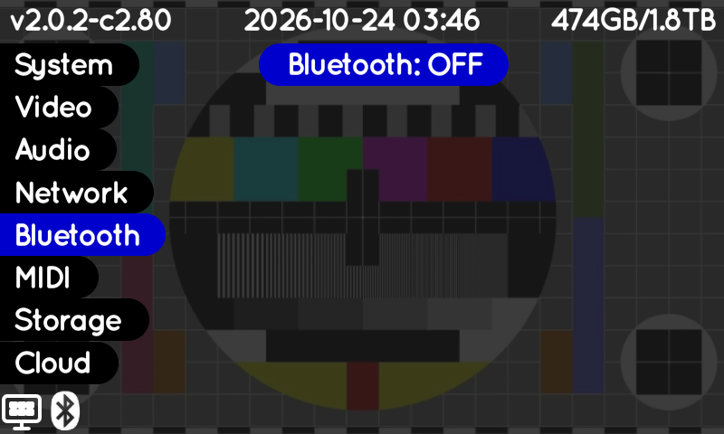<figcaption>
Settings — Bluetooth
</figcaption></figure>

### Bluetooth

Bluetooth device pairing and management. Supports MIDI controllers.
- **Bluetooth: ON** toggle button: enable or disable the Bluetooth radio
- Nearby and paired devices appear in a list below; a ">" marks a connected device and "[KB]" a Bluetooth keyboard
- Tap a nearby device to pair and connect it, or tap a paired device to disconnect and unpair it
- Each connected Bluetooth MIDI device gets its own In/Out switches on the MIDI tab

<figure>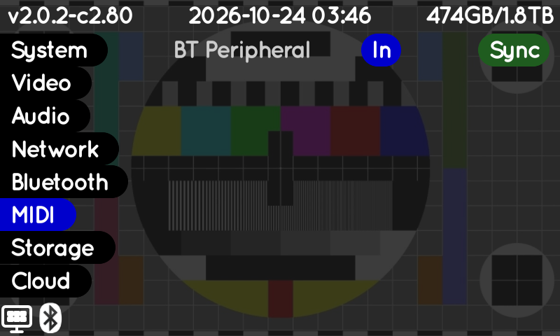<figcaption>
Settings — MIDI
</figcaption></figure>

### MIDI Devices

MIDI device management and routing.
- **Device list**: each connected MIDI device shown by name, including connected Bluetooth MIDI devices — "BT Peripheral" is the built-in Bluetooth MIDI (Mezzz controller)
- **In** toggle (blue): enable/disable receiving MIDI input from this device
- **Out** toggle (blue): enable/disable sending MIDI output to this device
- **Sync** toggle (green): enable/disable bidirectional clock/transport synchronization with this device
- Green = enabled, dark = muted/disabled

USB MIDI controllers connect plug-and-play with automatic detection and support for multiple simultaneous devices. For Bluetooth MIDI, enable Bluetooth in Settings, put the controller in pairing mode, and accept the connection when the popup appears.

<figure>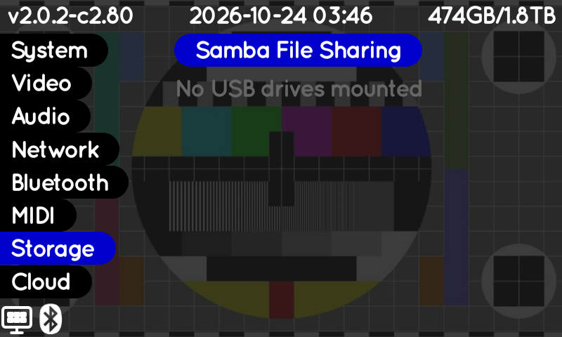<figcaption>
Settings — Storage
</figcaption></figure>

### Storage

Storage and network file sharing settings.

<figure>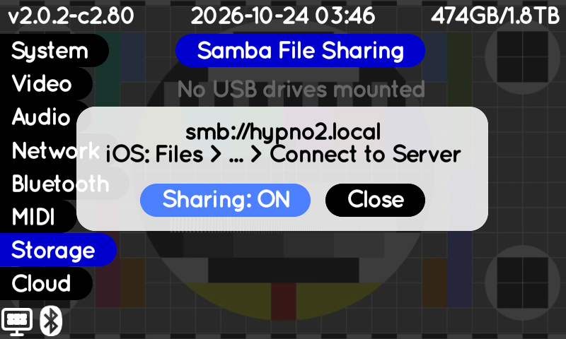<figcaption>
Settings — Samba File Sharing
</figcaption></figure>

- **Samba File Sharing**: opens a popup for sharing your Resources folder over the network (SMB). Its button reads **Install** if Samba is not installed yet (the Hypno 2 needs to be online), then **Sharing: OFF** / **Sharing: ON**; tap it to switch sharing, and **Close** to leave.
- When sharing is ON the popup shows the address to connect to from a computer on the same network (smb://<your device nickname>.local, e.g. smb://hypno2.local), and a hint for connecting from iOS (Files > ... > Connect to Server)
- **USB drive list**: shows connected USB drives with storage sizes
- "No USB drives mounted" message when no external drives are connected
- **Expand FS (+size)** appears when additional disk space can be claimed on an SSD (expands partition, do not interrupt this process)

### Cloud

<figure>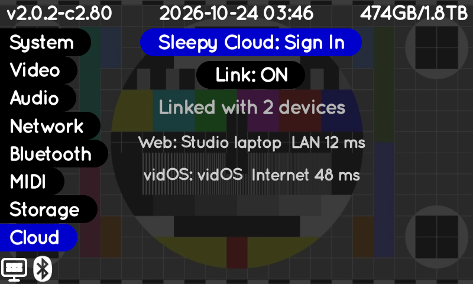<figcaption>
Settings — Cloud
</figcaption></figure>

Sleepy Cloud and System Link, in one tab. From the top:
- **Sleepy Cloud** row: **Sleepy Cloud: Install** (installs Sleepy Cloud over the network; the Hypno 2 must be online), then **Sleepy Cloud: Sign In** (the keyboard asks for your account name or email, then your password). Once signed in the row shows your account with a colored sync status dot. Tap it to open a panel with the sync status, storage used (and your plan's limit), active and queued transfers with their speed, and the buttons **Pause Transfers** / **Resume Transfers**, **Retry Failed (N)** (when some transfers failed), **Sign Out** and **Close**.
- **Folder: SleepyCloud/** (when signed in): opens your Sleepy Cloud folder in the file browser. See [Sleepy Cloud files](#sleepy-cloud-files) for how its files are marked and loaded.
- **System Link** rows, described below.

When signed in, presets and recordings made on the Hypno 2 are also uploaded to your Library in the background.

#### System Link

System Link links this Hypno 2 with vidOS on a computer and with shadygram.com, all signed in to the same Sleepy Cloud account. Linked devices follow each other: channels, mixer gains, the crossfader, seeks and loop markers, the knobs of Shader Chat shaders, tempo and transport (play/pause). Each channel's shader time is shared too, so a time-based shader shows the same picture on every linked device (shaders that build on their own previous frames, such as feedback, can still differ).

- Needs a signed-in Sleepy Cloud account (Settings > Cloud) with a verified Hypno 2.
- Off by default. Turn it on with the **Link: OFF / ON** switch in Settings > Cloud, under the Sleepy Cloud rows.
- **Status line** (under the switch): what the link is doing right now — off, signed out (sign in to Sleepy Cloud first), not verified (the account has no verified Hypno 2), connecting, waiting for another device, linked (with how many devices), or an error.
- A notice line appears under it when there is something to know, such as a video or shader from another device that could not be found on this one.
- **Device list**: one line per linked device — its type (Hypno 2, vidOS, Web, vidOS web), its name, the path it is linked over (**LAN**: same local network, **Internet**: direct over the internet, **Relay**: through a relay server) and the round-trip time in milliseconds ("-" until it is measured).
- Resampling while linked: a recording assigned to a channel plays on the Hypno 2 at once. Linked devices show that channel as "Uploading ... from Hypno 2" until the recording reaches your Library, then load it and play it in sync with the Hypno 2 (the same playhead, loop markers and speed). Presets saved meanwhile name the uploaded recording once it is there, so they open on other devices too.
- While linked, the Clock page SRC shows **LNK** and the tempo is shared by every linked device; set it from the Clock page of any of them.
- If the link drops, the Hypno 2 keeps its current state and tempo and carries on.

Encoders on this tab: left selects the tab, right selects the row and pressing it (or tapping) activates the row; with the link switch selected, center turns it on or off (tap: back to off).

## Hardware Map (Mezzz Integration)

<figure>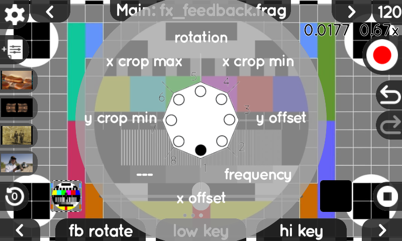<figcaption>
Mezzz Hardware Control Map
</figcaption></figure>

Visual overlay showing how hardware controls map to on-screen parameters. Press the center button on Mezzz to pull up this special map.
- **Center diagram**: circular layout of the Mezzz controller with labeled encoder positions
- **Parameter labels**: each encoder position shows the parameter it currently controls — rotation, x offset, y offset, x crop min, x crop max, y crop min, frequency, etc.
- The overlay renders on top of the live visual output so you can see both the map and the video simultaneously

## Shader Editor

<figure>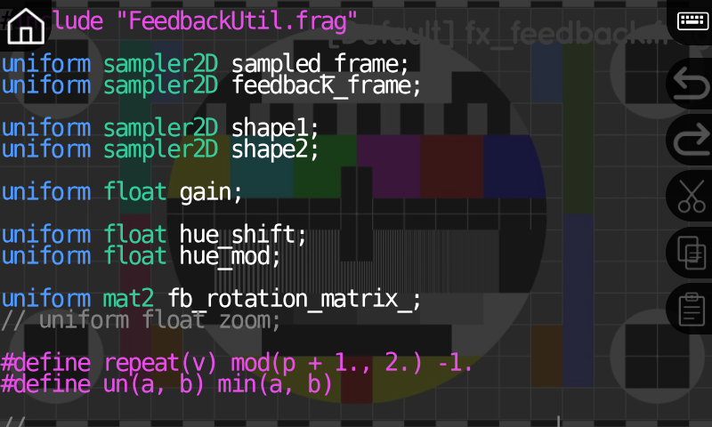<figcaption>
Shader Code Editor
</figcaption></figure>

Built-in GLSL fragment shader editor for creating and modifying custom visual effects. Select a shader (or any text file) in the browser and tap **View** to open it in the editor.
- **Code area**: GLSL source code with syntax highlighting — keywords (uniform, float) in different colors, types (sampler2D, mat2) highlighted, values and defines color-coded
- **Line numbers**: displayed on the left margin for easy navigation
- **Filename** shown in top-right corner (fx\_feedback.frag in this screenshot)
- **Buttons**: home icon at the top left (close the editor; if there are unsaved changes it asks **Save**, **Save As** or **Discard**), keyboard icon at the top right (show or hide the on-screen keyboard), and down the right side undo, redo, cut, copy, paste and save. The factory shaders can't be overwritten: save a changed copy with **Save As**.
- Touch the code area to place the cursor, or connect a USB/Bluetooth keyboard for faster editing
- **Left encoder**: move the cursor one character left/right (it wraps to the next or previous line)
- **Right encoder**: move the cursor up/down a line; it returns to the same column after passing shorter lines
- **Middle encoder**: with the cursor on a number, turn to raise or lower it; elsewhere it zooms the text
- **Right encoder push**: start or end a selection; while selecting, the three keys are cut, copy and paste
- **Keys** (left to right): unindent, comment/uncomment the line, indent
- **USB keyboard**: arrows, Home/End and Page Up/Down move the cursor (hold Shift to select); Alt or Ctrl with the arrows, Backspace or Delete works a word at a time; Tab inserts four spaces; Ctrl+C/X/V/A copy, cut, paste and select all; Ctrl+Z undoes, Ctrl+Y or Ctrl+Shift+Z redoes
- The cursor, Backspace and Delete always work on whole characters, including accented letters, emoji, flags and Chinese/Japanese text
- A shader that fails to compile turns the channel title red and shows the warning icon at the top right of the home screen; tap the icon to read the shader log

## Keyboard

On-screen keyboard for text input (search queries, file renaming, folder names, Wi-Fi passwords, the device nickname and password, Sleepy Cloud sign-in).
- **Header** (green bar): shows the current input mode — "Search Resources" in this screenshot
- **NO** button (top-left): cancel the input and close the keyboard
- **GO** button (top-right): confirm the input and submit
- **QWERTY layout**: three rows of letter keys (q-p, a-l, z-m)
- **Shift**: toggle between lowercase and uppercase letters
- **123**: switch to the numbers and common symbols page (the key reads **ABC** on the symbol pages and takes you back to the letters)
- **#+=**: extended symbols page
- **BKSP**: backspace — delete the character to the left of the cursor
- **Space**: insert a space character
- Hardware encoders move the text cursor left/right for precise positioning

USB keyboards are also supported for faster text entry.

## Live Video Inputs

### USB Cameras & Capture Cards

Connect UVC-compatible video cameras or capture cards via USB for live processing. A camera icon appears in the file browser when a compatible device is detected. The system automatically detects resolution and framerate. Multiple cameras can be connected simultaneously, and both channels can show the same camera. While a camera is on a channel, the file browser shows its live picture.

If a camera is unplugged or stops sending, its last picture stays on screen and Hypno 2 reconnects on its own as soon as the camera is back. A notification says when a camera is lost, when it is back, and when it cannot be opened.

USB capture cards with audio inputs are automatically detected and linked to their video counterparts, allowing synchronized audio-video capture from external sources like game consoles, cameras, or other video equipment.

### NDI Network Video

Hypno 2 can receive & send video and audio over your local network using NDI (Network Device Interface). NDI sources are automatically discovered and appear in the file browser. This enables wireless video input from computers, phones, or other NDI-capable devices. Both channels can show the same NDI source.

If an NDI source drops off the network, its last picture stays on screen and Hypno 2 reconnects on its own when the source returns.

## MIDI Control

MIDI support includes Transport, Clock, Control Change (CC) for parameter control, Note messages for preset save/recall, and per-channel chromatic video triggering.

### Connecting MIDI
Wired - Host, connect via USB Port
Wireless - Bluetooth Central, connect peripherals (such as Mezzz) via the settings menu
Wireless - Bluetooth Peripheral, check in your central device's settings to connect, there should be a device that is called "Hypno 2" visible on nearby BT central compatible hardware (phone, laptop etc.)

### MIDI Transport
MIDI ports with the Sync toggle on (Settings > MIDI) send and receive transport start/stop and clock messages. Control which clock is the driver at any point via the SRC setting on the [Clock page](#clockbpm-page): choose **EXT** to follow incoming MIDI clock. The MIDI clock the Hypno 2 sends follows the master tempo.

### MIDI Channel Routing

| MIDI Channel | Track | Purpose |
|---|---|---|
| 1 | Track A (Ch 1) | Video synthesizer channel A |
| 2 | Track B (Ch 2) | Video synthesizer channel B |
| 16 | Main / Master | Mixer gains and feedback FX |

### MIDI CC Remapping

Each parameter can be remapped to respond to any MIDI CC number (0-127), independent of its default CC assignment. Access the remapping in the modulation menu by selecting the MIDI CC badge and turning the right encoder to change the **cc#** value. The current mapped CC number displays as "ccX" in the modulation interface. MIDI mappings save with presets, allowing different controller configurations per patch.

### Chromatic Video Playback (MIDI Notes)

MIDI notes on **Channels 1 and 2** control chromatic pitch-shifting of video and audio playback. This turns any MIDI keyboard or sequencer into a chromatic video instrument — each key plays the loaded video/audio at a different pitch and preserves speed (if clock sync is enabled)

**How it works:**
- **Middle C (note 60)** = normal playback speed (no transposition)
- Each semitone above middle C speeds up playback by a factor of 2^(1/12) (approximately 1.059x)
- Each semitone below middle C slows down playback by the same ratio
- One octave up (note 72) = double speed, one octave down (note 48) = half speed
- Range: approximately 4 octaves in either direction

**Behavior:**
- Each **note-on** retriggers the video from its loop start point, so you can rhythmically re-trigger clips
- **Note-off** holds the last transpose value — the video continues playing at the transposed pitch until a new note is pressed
- **Velocity** is used only for note-on/off detection (not mapped to volume or other parameters)
- MIDI Channel 1 controls Track A, Channel 2 controls Track B

| Note | Name | Transpose | Speed Factor |
|---|---|---|---|
| 48 | C2 | -12 semitones | 0.5x (half speed) |
| 54 | F#2 | -6 semitones | 0.71x |
| 60 | C3 (Middle C) | 0 | 1.0x (normal) |
| 66 | F#3 | +6 semitones | 1.41x |
| 72 | C4 | +12 semitones | 2.0x (double speed) |
| 84 | C5 | +24 semitones | 4.0x |

### Playing Videos from a Computer Keyboard

A USB keyboard can play the selected channel the same way a MIDI keyboard does. Channel 1 plays Track A, and Channel 2 plays Track B. When Main is selected, the keys play Track A.

- **A W S E D F T G Y H U J K**: one octave, C to C. The home row is the white keys and the row above is the black keys. **A** is middle C (normal speed).
- **Z / X**: shift down or up an octave (up to 4 octaves either way)
- Each key press restarts the video at that key's pitch. Holding a key does not retrigger it.
- **Space**: pause or play the selected channel. When Main is selected, it pauses or plays everything.
- The keys don't play notes while the shader editor, a text file, or the on-screen keyboard is open, so typing stays typing.

### Preset Save/Load via MIDI Notes

MIDI notes on **Channels 3-16** trigger preset save and load. Each note number (0-127) acts as a preset slot, and each MIDI channel has its own set of slots.

- **Short press** (note-on then note-off): load the most recent preset saved to that note slot
- **Long hold** (hold the note): save the current state to that note slot
- Presets are stored per-channel and per-note in `Resources/Presets/MIDI/`

This allows MIDI sequencers or foot controllers to recall different visual states on the fly during performance.

### Default MIDI CC Map

#### Track A (MIDI Ch 1) & Track B (MIDI Ch 2)

Parameters on Channels 1 and 2 vary by loaded shader. The table below shows common default assignments:

| CC | Parameter | Description |
|---|---|---|
| 0 | x offset | Horizontal position |
| 1 | frequency | Animation speed |
| 2 | y offset | Vertical position |
| 3 | x crop min / fold axis | Horizontal crop left edge (shader-dependent) |
| 4 | rotation | Rotation angle |
| 5 | x crop max / fold shape | Horizontal crop right edge (shader-dependent) |
| 6 | y crop min / aspect x | Vertical crop top edge (shader-dependent) |
| 7 | polarization | Polarization effect amount (shader-dependent) |
| 8 | y crop max / aspect y | Vertical crop bottom edge (shader-dependent) |
| 9 | aspect x / luma min | Horizontal stretch (shader-dependent) |
| 10 | --- | Unassigned (shader-dependent) |
| 11 | aspect y / luma max | Vertical stretch (shader-dependent) |
| 12 | mirror amt | Mirror effect intensity |
| 13 | mirror rot | Mirror axis rotation |
| 14 | --- | Unassigned |
| 15 | luma min | Luminance low threshold |
| 16 | polarization | Polarization amount |
| 17 | luma max | Luminance high threshold |
| 18-59 | (shader-dependent) | Additional shader parameters |
| 60 | --- | Unassigned |
| 61 | cross mod | Cross-channel modulation amount |
| 62 | fb mod amt | Feedback modulation depth |
| 63 | hue | OKLab hue shift |
| 64 | chrominance | OKLab color saturation |
| 65 | lightness | OKLab brightness |
| 66-127 | mod CC 0-61 | Modulation LFO control (mod CC = base CC + 66) |


When a **Sampler** shader is loaded with multi-frame video, CCs 0-2 are reserved for **loop in**, **framerate**, and **loop out** controls. Shader parameters shift to start at CC 3. Loop in and loop out are also the markers on the channel's seek bar. Turning the framerate knob taps (haptics) as it reaches normal speed forward, stopped, and normal speed backward.


#### Main / Master (MIDI Ch 16)

| CC | Parameter | Description |
|---|---|---|
| 0 | ch1 gain | Track A video level in the mix |
| 1 | feedback | Frame-to-frame feedback amount |
| 2 | ch2 gain | Track B video level in the mix |
| 3 | fb x | Feedback horizontal offset |
| 4 | fb zoom | Feedback zoom/scale |
| 5 | fb y | Feedback vertical offset |
| 6 | fb rotate | Feedback rotation angle |
| 7 | low key | Luminance keying low threshold |
| 8 | hi key | Luminance keying high threshold |

## Desktop Mode (Raspberry Pi OS)

Switch to desktop mode through Settings > "Go to Desktop" to access the Raspberry Pi operating system. In this mode the hardware controls are remapped for desktop navigation:

**Encoders:**
- Left encoder: mouse X movement
- Center encoder: mouse scroll wheel
- Right encoder: mouse Y movement

**Encoder taps:**
- Left encoder tap: right mouse click
- Center encoder tap: middle mouse click
- Right encoder tap: left mouse click

**Buttons:**
- Left button: ESC key
- Center button: SPACE key
- Right button: ENTER key
- Left + Right buttons simultaneously: F11 fullscreen toggle

This allows full desktop navigation without external peripherals. Useful for recovery or general hacking, comes pre loaded with useful open source software.

### SD Card Copier (Copy SSD)
If upgrading to a different SSD you can use this utility + an M.2 NVMe USB reader to copy out your ssd to a larger drive. When rebooting to vidos, look for an "Expand Filesystem" button in settings to utilize all the new space.

### Returing to VIDOS
Open the "VIDOS" desktop shortcut to reboot system back into the normal Hypno 2 Video Operating system.


Need help? Check the [FAQ](hypno-2-faq.md) or [Troubleshooting Guide](hypno-2-troubleshooting.md)

